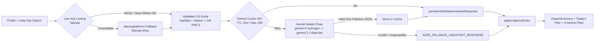

# Urban Air Quality Assistant

[](../../actions/workflows/ci.yml)

A GenAI-powered web application that helps urban households across India navigate winter smog and particulate pollution with practical daily routines, indoor air hygiene, sustainable alternatives, and household-specific health alerts grounded in live telemetry.

## Chosen Vertical

**Challenge 6 — Urban Air Quality Assistant**: Built for households and individuals in smog-prone Indian cities (including Delhi, Noida, Mumbai, Kolkata, Lucknow, and Hyderabad), covering parents with children, older adults, working professionals, student athletes, people with respiratory sensitivities, and remote households.

## Evaluation Criteria -> Where to Look

| Criterion             | Exact Files                                                                                                                                                                                                                                            | Verification Commands                                                                                                                          |
| --------------------- | ------------------------------------------------------------------------------------------------------------------------------------------------------------------------------------------------------------------------------------------------------ | ---------------------------------------------------------------------------------------------------------------------------------------------- |
| **Code Quality**      | `eslint.config.js`, `tsconfig.json`, `.prettierrc`, `.editorconfig`, `.nvmrc`, `src/tests/architecture.test.ts`, `shared/`, `server/`, `src/`                                                                                                          | `npm run typecheck`, `npm run lint`, `npm run format:check`, `npm run arch:check`                                                              |
| **Security**          | `docs/SECURITY.md`, `server/lib/config.ts`, `server/lib/logger.ts`, `server/middleware/securityMiddleware.ts`, `server/middleware/httpHardeningMiddleware.ts`, `shared/utils/sanitizing.ts`, `.github/workflows/codeql.yml`                            | `npx vitest run src/tests/server/security.test.ts src/tests/server/httpHardening.test.ts src/tests/server/logger.test.ts`                      |
| **Efficiency**        | `server/providers/geminiCache.ts`, `server/providers/geminiChain.ts`, `server/providers/geminiTransport.ts` (`ThinkingLevel.LOW`), `src/hooks/useCooldown.ts`, `src/features/profile/useCityAutocomplete.ts` (`250 ms` debounce + `AbortController`)   | `npx vitest run src/tests/server/geminiCache.test.ts src/tests/server/geminiFallback.test.ts src/tests/hooks/useAssistantCancellation.test.ts` |
| **Testing**           | `vitest.config.ts`, `docs/TESTING.md`, `src/tests/` (`46` test files, `132` tests covering server security, providers, AI fallback/cache, hooks, utils, UI, and `<App />` flows)                                                                       | `npm test`, `npm run test:coverage`                                                                                                            |
| **Accessibility**     | `src/App.tsx`, `src/components/AqiGauge.tsx`, `src/components/ErrorBanner.tsx`, `src/features/profile/LocationCard.tsx`, `src/hooks/useResultsHeadingFocus.ts`, `src/tests/features/Accessibility.test.tsx`, `src/tests/features/ProfileForm.test.tsx` | `npx vitest run src/tests/features/Accessibility.test.tsx src/tests/features/ProfileForm.test.tsx src/tests/features/App.test.tsx`             |
| **Problem Alignment** | `docs/AI_DESIGN.md`, `docs/SAMPLE_INPUTS.md`, `docs/adr/`, `shared/constants/prompts.ts`, `shared/constants/aqi.ts`, `src/constants/samples.ts`, `src/utils/urgencyRules.ts`, `shared/utils/dailyPlan.ts`, `shared/utils/outdoorWindow.ts`             | `npm run build` and interactive walkthrough using the `6` scenarios in `src/constants/samples.ts`                                              |

## Approach & Logic

1. **Location & Profile Resolution**: `useProfile` (`src/hooks/useProfile.ts`) validates household attributes (`familyType` including `Working professional` and `Student`, sensitivity flags for children, older adults, and respiratory conditions, `commuteMode`, and `homeType`) via `shared/utils/validation.ts`. `LocationCard` (`src/features/profile/LocationCard.tsx`) offers **India-only city search with autocomplete** (`GET /api/cities?q=...` powered by Open-Meteo Geocoding with `countryCode=IN`, debounced at `250 ms` with `AbortController` cancellation) alongside direct city entry.
2. **Live AQI Proxy & Integrity**: `GET /api/aqi` (`server/routes/aqiHandler.ts`) validates the city name (and optional `lat`/`lon` coordinates supplied when selecting an Indian city suggestion), queries **WAQI** when `AQI_API_KEY` is configured while enriching with Open-Meteo 24-hour hourly PM2.5 (`hourly=pm2_5`), or falls back directly to **Open-Meteo Air Quality** (`us_aqi`, `pm2_5`, `pm10`, `nitrogen_dioxide`, `ozone`, `hourly=pm2_5`). Raw live AQI readings above `500` are preserved without rejection, classified as **Hazardous**, and tagged `"above scale"`. Stations outside India (`INDIA_GEO_BOUNDS`) or farther than `50 km` (`MAX_STATION_DISTANCE_KM`) trigger a visible warning banner. If live lookup fails or the user switches manually, `ManualAqiForm` accepts AQI (`0–500`) plus optional PM2.5 (`0–1000 ug/m3`) and PM10 (`0–2000 ug/m3`) and labels the output `"Manual entry"`.
3. **Structured Gemini Chain & Response Cache**: `POST /api/assistant/recommendations` (`server/routes/geminiHandler.ts`) validates `UserProfile` and `AqiData`, sanitizes free-text fields (`sanitizeAqiData`), and checks a bounded FIFO in-memory cache (`server/providers/geminiCache.ts`: max `100` entries, `10`-minute TTL, keyed by sanitized cities, persona/sensitivity/commute/home fields, AQI rounded to nearest `10`, and UTC `YYYY-MM-DDTHH`). On cache miss, it sends a deterministic prompt (`buildAssistantPrompt`, including Morning/Afternoon/Evening slots from **Today's plan**) to `GEMINI_MODEL_CHAIN` (`gemini-4-hydrogen` -> `gemini-3.1-flash-lite`) with `ThinkingLevel.LOW`, `maxOutputTokens: 4096`, `20 s` per-attempt timeout, and a `45 s` total budget (inside the `60 s` HTTP server timeout). On `503` or `429`, it retries that model once after `800 ms` before advancing; on timeout, `404`, or model-unavailable errors, it skips immediately; if every model fails with `503`/`429`, it returns HTTP `503` (`"The AI service is busy. Please try again in a moment."`). Only validated non-fallback responses (`!isFallback`) are cached.
4. **Deterministic US EPA Urgency Layer**: `parseAndValidateAssistantResponse` (`shared/utils/assistantParser.ts`) validates model JSON (falling back to `SAFE_FALLBACK_ASSISTANT_RESPONSE` if invalid/unparseable), and `applyUrgencyRules` (`src/utils/urgencyRules.ts`) evaluates readings on the **AQI (US scale, as reported by WAQI and Open-Meteo)**: stay-indoors + fitted N95/KF94 `HEALTH_ALERT` priority starts at **101** (`Unhealthy for Sensitive Groups`) for households with children, older adults, or respiratory sensitivities, and at **151** (`Unhealthy`) for all households.



## Features

- **US EPA AQI Gauge & Station Transparency**: Circular gauge colored by **AQI (US scale, as reported by WAQI and Open-Meteo)** (`Good` 0–50, `Moderate` 51–100, `Unhealthy for Sensitive Groups` 101–150, `Unhealthy` 151–200, `Very Unhealthy` 201–300, `Hazardous` 301–500, plus `>500` live readings treated as Hazardous with an `"above scale"` badge). Displays the city/country headline, distinct monitoring `Station` name when available, formatted timestamp (`updatedAt`), source badge (`Live WAQI`, `Live Open-Meteo`, `Live reading`, or `Manual entry`), and any non-India / `>50 km` distance warning.
- **PM2.5 & PM10 vs. WHO 24h Guidelines**: Displays PM2.5 alongside the `15.0 ug/m3` WHO 24h guideline and PM10 (or `N/A` when omitted) alongside the `45.0 ug/m3` WHO 24h guideline, with optional manual PM2.5 and PM10 inputs.
- **Today's Plan & Best Outdoor Window**: When hourly PM2.5 data is present, renders **Today's plan** (**Morning** `6 AM – 12 PM`, **Afternoon** `12 PM – 5 PM`, **Evening** `5 PM – 10 PM`) with expected PM2.5 and tailored action alongside the **Best time for outdoor activity** 2-hour window, and passes those slots to Gemini.
- **India-Only City Search**: Autocomplete powered by Open-Meteo Geocoding (`countryCode=IN`), supporting Indian metros and towns while passing resolved coordinates to `/api/aqi`.
- **Personas & Indian-Home Guidance**: Tailored for parents with children, seniors, working professionals, and **Student** outdoor sports/activity planning, plus wet mopping, clean-window ventilation timing, room-sized HEPA CADR, minor houseplant caveat, and low-cost DIY options. Shows a slow-loading notice (`"Generating your plan, this can take up to 40 seconds"`) after `5` seconds of loading. See `docs/SAMPLE_INPUTS.md` for all six quick-select walkthrough scenarios.

## Architecture & Folder Structure

- `shared/` — Cross-runtime constants, types, and pure helpers shared by client and server (`shared/constants/`: `aqi.ts`, `config.ts`, `dailyPlan.ts`, `http.ts`, `limits.ts`, `prompts.ts`, `server.ts`; `shared/types/index.ts`; `shared/utils/`: `aqiValidation.ts`, `assistantParser.ts`, `dailyPlan.ts`, `errors.ts`, `formatting.ts`, `locationValidation.ts`, `math.ts`, `outdoorWindow.ts`, `promptBuilder.ts`, `sanitizing.ts`, `typeGuards.ts`, `validation.ts`).
- `server.ts` & `server/` — Express entry point (`60 s` HTTP request timeout) plus `server/app.ts` composition root, `server/lib/` (`config.ts`, `errorResponse.ts`, `logger.ts`), `server/middleware/` (`httpHardeningMiddleware.ts`, `requestContext.ts`, `securityMiddleware.ts`), `server/providers/` (`aqiProviders.ts`, `geminiCache.ts`, `geminiChain.ts`, `geminiErrors.ts`, `geminiSchema.ts`, `geminiTransport.ts`, `hourlyForecastProvider.ts`, `openMeteoMapper.ts`, `providerDeps.ts`, `waqiNormalize.ts`, `waqiProvider.ts`), and `server/routes/` (`aqiHandler.ts`, `aqiLookup.ts`, `citiesHandler.ts`, `geminiHandler.ts`, `healthHandler.ts`).
- `src/components/` — Presentational UI primitives (`AppChrome`, `AqiGauge`, `ChipToggle`, `EmptyIllustration`, `ErrorBanner`, `ErrorBoundary`, `Icons`, `LoadingSkeleton`, `ProfileIcons`, `ProgressBar`, `SectionCard`, `SectionCategoryIcon`, `SegmentedControl`, `SensitivityIcon`, `SeverityBadge`, `ThemeToggle`).
- `src/constants/` — Client-specific constants (`samples.ts`, `uiTheme.ts`, `urgencyTemplates.ts`).
- `src/features/` — `profile/` (`ProfileForm`, `LocationCard`, `CitySuggestionsList`, `profileCityInput`, `profileFields`, `profileSelectPreferenceCards`, `profileSuggestionsHelpers`, `useCityAutocomplete`), `impact/` (`AqiHeroCard`, `ImpactSummary`, `ManualAqiForm`, `ManualMetricField`, `OutdoorMetricsGrid`, `OutdoorWindowCard`, `TodaysPlanCard`), and `assistant/` (`EmptyRecommendationsState`, `RecommendationCard`, `RecommendationList`, `WhyThesePanel`).
- `src/hooks/` — Request and state orchestration (`useAppWorkspace`, `useAssistant`, `useAssistantExecution`, `assistantRunner`, `useCooldown`, `useProfile`, `useResultsHeadingFocus`) with `AbortController` cancellation, submit cooldown notice, and mode-preserving retry.
- `src/services/` — Typed browser API clients (`aqiPayloadParser.ts`, `aqiService.ts`, `citySearchService.ts`, `geminiService.ts`, `httpClient.ts`).
- `src/utils/` — Client-only domain calculations (`aqiCalculations.ts`, `urgencyRules.ts`).
- `docs/` — `AI_DESIGN.md`, `ARCHITECTURE.md`, `SECURITY.md`, `TESTING.md`, `SAMPLE_INPUTS.md`, `openapi.yaml`, and `docs/adr/` (`001`–`006`).

## Security & Observability

- **Zero Client Secrets & 12-Factor Config**: `server/lib/config.ts` reads and validates `PORT`, `GEMINI_API_KEY`, `AQI_API_KEY`, and `NODE_ENV` once at startup into an immutable frozen object. If `GEMINI_API_KEY` is missing, startup warns safely and `POST /api/assistant/recommendations` returns HTTP `503`. Keys never enter client bundles, logs, or responses.
- **Structured Logging & Health**: `server/lib/logger.ts` emits single-line JSON logs with automatic redaction of registered secrets, key patterns, tokens, and sensitive keys. `server/middleware/requestContext.ts` correlates requests via `x-request-id` and logs method, path, status, and duration without request bodies. `GET /api/health` (`server/routes/healthHandler.ts`) reports `{ status: "ok", uptimeSeconds, version }` without calling external APIs.
- **HTTP Hardening & Rate Limiting**: `applySecurityHeaders` (`server/middleware/securityMiddleware.ts`) sets `X-Content-Type-Options: nosniff`, `X-Frame-Options: SAMEORIGIN`, `Referrer-Policy`, `Permissions-Policy` (disabling camera, microphone, geolocation, payment, and USB), `Cross-Origin-Opener-Policy`, `Cross-Origin-Resource-Policy`, `X-DNS-Prefetch-Control`, HTTPS-only `Strict-Transport-Security`, and strict CSP (`script-src 'self'` in production). `server/middleware/httpHardeningMiddleware.ts` enforces explicit same-origin CORS, `415` JSON `Content-Type`, and `405` with `Allow` headers. Bounded per-IP rate limiting (`30` requests/minute, max `1000` tracked IPs) and a `16kb` JSON body cap protect `/api/*`. See `docs/SECURITY.md`.
- **Boundary Validation & UI Resilience**: Coordinates (`[-90, 90]`, `[-180, 180]`), city text sanitization (`sanitizeText`), runtime type guards, manual AQI (`0–500`) / PM2.5 (`0–1000`) / PM10 (`0–2000`) bounds, plain-text React rendering, and a root `ErrorBoundary` prevent crashes and malformed payloads.

## Testing

The `src/tests/` suite runs on **Vitest**, **@testing-library/react**, **@testing-library/jest-dom**, and **vitest-axe** (`jsdom`, configured in `vitest.config.ts` and `src/tests/setup.ts`) with `@vitest/coverage-v8` thresholds (`85%` statements/functions/lines, `75%` branches) across **46 test files (132 tests)**:

- `src/tests/architecture.test.ts` (`1` file): Static import-graph & zero-cycle verification across `shared/`, `src/`, `server/`, and `server.ts`.
- `src/tests/components/` (`5` files): `ErrorBanner.test.tsx`, `ErrorBoundary.test.tsx`, `LoadingSkeleton.test.tsx`, `ProgressBar.test.tsx`, `ThemeToggle.test.tsx`.
- `src/tests/constants/` (`1` file): `aqi.test.ts`.
- `src/tests/features/` (`8` files): `Accessibility.test.tsx`, `App.test.tsx`, `AppRequestState.test.tsx`, `AssistantErrors.test.tsx`, `ImpactSummary.test.tsx`, `ManualAqiForm.test.tsx`, `ProfileForm.test.tsx`, `RecommendationCard.test.tsx`.
- `src/tests/hooks/` (`6` files): `assistantRunner.test.ts`, `useAssistant.test.ts`, `useAssistantCancellation.test.ts`, `useCityAutocomplete.test.ts`, `useCooldown.test.ts`, `useProfile.test.ts`.
- `src/tests/server/` (`13` files): `app.test.ts`, `aqiHandler.test.ts`, `citiesHandler.test.ts`, `config.test.ts`, `geminiCache.test.ts`, `geminiErrorsAndCache.test.ts`, `geminiFallback.test.ts`, `handlers.test.ts`, `httpHardening.test.ts`, `logger.test.ts`, `observability.test.ts`, `openapi.test.ts`, `security.test.ts`.
- `src/tests/services/` (`3` files): `aqiService.test.ts`, `geminiService.test.ts`, `httpClient.test.ts`.
- `src/tests/utils/` (`9` files): `aqiCalculations.test.ts`, `dailyPlan.test.ts`, `errors.test.ts`, `formatting.test.ts`, `locationValidation.test.ts`, `outdoorWindow.test.ts`, `parserAndSanitizing.test.ts`, `urgencyRules.test.ts`, `validation.test.ts`.
- Shared helpers in `src/tests/fixtures/` (`assistantFixtures.ts`, `serverHarness.ts`, `testApp.ts`).

See `docs/TESTING.md` for suite-by-suite coverage details.

## Setup & Deployment

**Prerequisites**: Node.js `22` (`.nvmrc`; engine `>= 22.6.0`) with `npm` or [Bun](https://bun.sh/) (`bun.lock`).

1. Copy `.env.example` to `.env` and configure:
   - `GEMINI_API_KEY` (required for AI recommendations)
   - `AQI_API_KEY` (optional WAQI token; falls back to Open-Meteo when unset)
   - `PORT` (optional HTTP port; defaults to `3000`; server binds on `0.0.0.0`)
2. Install and run locally:

```bash
npm install        # or: bun install
npm run dev        # or: bun run dev
```

## Scripts

All scripts defined in `package.json` (runnable with `npm run <script>` or `bun run <script>`):

- `dev` (`tsx server.ts`) — Starts the Express + Vite middleware development server.
- `start` (`NODE_ENV=production node server.ts`) — Starts the Express production server serving `dist/`.
- `build` (`vite build`) — Compiles the production Vite client bundle.
- `preview` (`vite preview`) — Previews the built Vite client bundle locally.
- `clean` (`rm -rf dist coverage`) — Removes build and coverage output directories.
- `lint` (`eslint . --max-warnings 0`) — Runs zero-warning strict ESLint across the repository.
- `typecheck` (`tsc --noEmit`) — Runs strict TypeScript type-checking.
- `format` (`prettier --write .`) — Formats all repository files with Prettier.
- `format:check` (`prettier --check .`) — Verifies Prettier formatting without modifying files.
- `test` (`vitest run`) — Runs the full Vitest unit and integration test suite.
- `test:coverage` (`vitest run --coverage`) — Runs Vitest and enforces v8 coverage thresholds (`85%` statements/functions/lines, `75%` branches).
- `arch:check` (`madge --ts-config tsconfig.json --extensions ts,tsx --circular shared src server server.ts`) — Verifies zero circular dependencies across shared, client, and server code.
- `check` (`npm run lint && npm run typecheck && npm run format:check && npm run arch:check && npm test && npm run build`) — Runs full verification pipeline in order.

## Data Sources, Assumptions & Limitations

- **Scale**: Both **Open-Meteo Air Quality** (`us_aqi`) and **WAQI** (`aqi` feeds) report AQI on the **US scale (`0–500`)**; raw values above `500` from monitoring stations are accepted, classified as Hazardous, and tagged `"above scale"`.
- **Data Sources**: Live air metrics use **WAQI** (`api.waqi.info`) when `AQI_API_KEY` is configured or **Open-Meteo** (`open-meteo.com`) as keyless fallback; Indian city search queries Open-Meteo Geocoding with `countryCode=IN`; 24h hourly PM2.5 forecasts come from Open-Meteo (`hourly=pm2_5`); WHO 24-hour guidelines cite the 2021 WHO Global Air Quality Guidelines (`15 ug/m3` PM2.5, `45 ug/m3` PM10).
- **Conditional Hourly Sections**: If Open-Meteo hourly PM2.5 data is unavailable or the user submits via manual entry, both **Today's plan** and **Best time for outdoor activity** are hidden.
- **Educational Estimates**: Combined PM2.5 reduction percentages are heuristic estimates rather than clinical measurements.
