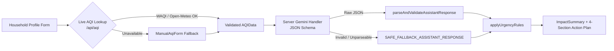

# Urban Air Quality Assistant

A GenAI-powered web application that helps urban families and communities navigate winter smog and high-particulate pollution with practical, low-emission daily routines, indoor air hacks, sustainable alternatives, and household-specific health alerts.

## Chosen Vertical

**Challenge 6 — Urban Air Quality Assistant**: Designed for households living in smog-prone metro areas (such as New Delhi, Lahore, and Beijing), including families with young children, older adults, people with respiratory sensitivities, and active outdoor commuters who need actionable guidance tailored to live local AQI levels.

## Approach & Logic

1. **Profile & Live AQI Resolution**: `useProfile` validates city and household attributes (`familyType`, vulnerability flags, `commuteMode`, `homeType`). On submit, `useAssistant` requests live AQI via `GET /api/aqi` (trying WAQI when `AQI_API_KEY` is configured, falling back to Open-Meteo Geocoding + Air Quality APIs, or prompting `ManualAqiForm` if unavailable).
2. **Structured Gemini Generation**: `POST /api/assistant/recommendations` validates the profile and `AQIData` payload on the server, builds a contextual prompt via `buildAssistantPrompt`, and invokes `@google/genai` (`gemini-4-hydrogen`) with `responseMimeType: 'application/json'` and `ASSISTANT_RESPONSE_SCHEMA`.
3. **Validation & Fallback**: `parseAndValidateAssistantResponse` sanitizes strings (`readStringField`), clamps `estimatedPM25Reduction` to `0–100`, validates categories, and falls back safely to `SAFE_FALLBACK_ASSISTANT_RESPONSE` if model JSON is malformed.
4. **Deterministic Urgency Layer**: `applyUrgencyRules` scores urgency (`CRITICAL`, `HIGH`, `STANDARD`), guarantees a `Stay Indoors` + N95/KF94 `HEALTH_ALERT` card first under severe AQI or unhealthy AQI with respiratory sensitivity, adds commute/housing rules, and sorts recommendations by severity.



## Features

- **Household Profile Form**: City input with live inline validation, family structure selector, toggle chips for children/elderly/respiratory sensitivities, commute mode, and home type.
- **Live & Manual AQI Hero Gauge**: Circular category-colored US AQI gauge, WHO 24h PM2.5 guideline comparison (`15 ug/m3`), live/manual badge, and instant manual AQI + optional PM2.5 fallback.
- **Four-Section Tailored Plan**: Categorized cards for Health Alerts, Daily Routine (Low-Emission), Indoor Air Hacks, and Sustainable Alternatives.
- **Direct PM2.5 Impact**: Every recommendation card highlights a plain-text `"Direct impact"` rationale and per-action PM2.5 reduction %, rolled up by `calculateTotalPM25Reduction` into an overall exposure reduction bar.
- **Responsive Light/Dark Theme**: Calm health-tech UI with `prefers-color-scheme` support, loading skeletons, sample scenario chips, cooldown guard, and retry/dismiss error banners.

## Architecture & Folder Structure

- `server/` — Express route handlers (`aqiHandler.ts`, `geminiHandler.ts`), provider clients, safe error mapper, and security middleware (`securityMiddleware.ts`).
- `src/components/` — Reusable presentational UI primitives (`AqiGauge`, `ProgressBar`, `ErrorBanner`, `ThemeToggle`, `SectionCard`, inline SVG icons).
- `src/constants/` — Centralized AQI thresholds, Gemini prompts/fallback, UI theme tokens, sample profiles, rate limits, and error strings.
- `src/features/` — Domain feature views split into `profile/`, `impact/`, and `assistant/`.
- `src/hooks/` — Custom state orchestration hooks (`useProfile`, `useAssistant`) with mode-preserving retry and submit cooldown handling.
- `src/services/` — Typed browser API clients (`aqiService.ts`, `geminiService.ts`, `httpClient.ts`) using runtime payload type guards.
- `src/types/` — Shared TypeScript interfaces and `as const` enum-like constants compatible with strict TypeScript and Node type-stripping.
- `src/utils/` — Pure helpers for validation (`isRecord`, `validateCity`), text sanitization, AQI math, formatting, prompt building, JSON parsing, and `applyUrgencyRules`.
- `src/tests/` — Vitest unit, server handler/security, and React Testing Library component/feature integration tests.

## Security

- **Zero Client Secrets**: `GEMINI_API_KEY` and optional `AQI_API_KEY` are read exclusively on the Express server and never bundled, logged, or returned in API errors.
- **HTTP Headers & CSP**: `applySecurityHeaders` sets `X-Content-Type-Options: nosniff`, `X-Frame-Options: SAMEORIGIN`, `Referrer-Policy: strict-origin-when-cross-origin`, and environment-specific `Content-Security-Policy` headers.
- **Abuse Controls**: `app.set('trust proxy', 1)` resolves client IPs behind reverse proxies, while `createApiRateLimiter` enforces a bounded per-IP fixed window (`30` requests / `60s` on `/api`, `429` with `Retry-After`) alongside a `16kb` Express JSON body limit.
- **Input & Output Hardening**: Strict boundary validation (`validateUserProfile`, `validateAQIData`, `validateManualAqi`), control-character stripping (`sanitizeText`), and React plain-text rendering without `dangerouslySetInnerHTML`.

## Accessibility

- Visible `<label>` elements, `aria-invalid`, `role="alert"`, and `aria-describedby` linking inputs to hints and inline validation messages.
- Native `<progress>` bar paired with a visible percentage text readout, keyboard-focusable controls (`min-h-11` targets), and `aria-live="polite"` / `aria-busy` updates on the results column.
- WCAG AA contrast color tokens across both light and dark themes.

## Testing

The `src/tests/` suite uses **Vitest** and **React Testing Library** (`jsdom`) covering AQI calculations, validation guards, urgency rules, response parsing, hooks, service error handling, Express validation/security middleware, and accessible UI behavior (`ProfileForm`, `RecommendationCard`, `ErrorBanner`, `ManualAqiForm`, `ProgressBar`, and `App` end-to-end flow).

## Setup

**Prerequisites**: [Bun](https://bun.sh/) (matches `bun.lock`) or Node.js `>= 22` + `npm`.

1. Copy `.env.example` to `.env` and set your keys:
   - `GEMINI_API_KEY` (required for AI recommendations)
   - `AQI_API_KEY` (optional WAQI token; falls back to Open-Meteo if omitted)
2. Install dependencies and start the development server on port `3000`:

```bash
bun install        # or: npm install
bun run dev        # or: npm run dev
```

3. Run checks or build for production:

```bash
bun run lint         # or: npm run lint
bun run format:check # or: npm run format:check
bun run test         # or: npm run test
bun run build        # or: npm run build
bun run start        # or: npm run start (serves dist/ in production on port 3000)
```

## Assumptions & Limitations

- PM2.5 exposure reduction percentages are heuristic estimates for educational planning rather than clinical or sensor-calibrated measurements.
- Open-Meteo and WAQI availability varies by city; manual AQI entry ensures resilience when external APIs fail or rate-limit.
- The per-IP rate limiter stores counters in process memory (pruned when exceeding `MAX_TRACKED_IPS`) and assumes `trust proxy = 1` behind a single reverse-proxy hop; counters reset on server restart and are not shared across multiple instances.
