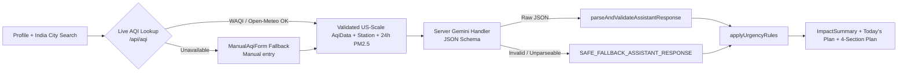

# Urban Air Quality Assistant

A GenAI-powered web application that helps urban households across India navigate winter smog and particulate pollution with practical, low-emission daily routines, indoor air hacks, sustainable alternatives, and household-specific health alerts.

## Chosen Vertical

**Challenge 6 — Urban Air Quality Assistant**: Built for households and individuals in smog-prone Indian cities (including Delhi, Noida, Mumbai, Kolkata, Lucknow, and Hyderabad), covering parents with children, seniors, working professionals, student athletes, people with respiratory sensitivities, and active commuters.

## Approach & Logic

1. **Location & Profile Resolution**: `useProfile` validates household attributes (`familyType` including `Working professional` and `Student`, sensitivity flags, `commuteMode`, `homeType`). `LocationCard` offers **India-only city search** (`GET /api/cities?q=...` powered by Open-Meteo Geocoding with `countryCode=IN`) alongside direct city entry.
2. **Live AQI Proxy & Integrity**: `GET /api/aqi` requires a validated city name (with optional `lat`/`lon` coordinates when picked from Indian city suggestions), tries **WAQI** (`geo:lat;lon` or city feed) when `AQI_API_KEY` is configured while enriching with Open-Meteo 24-hour hourly PM2.5, or falls back directly to **Open-Meteo Air Quality** (`us_aqi`, `pm2_5`, `pm10`, `nitrogen_dioxide`, `ozone`, `hourly=pm2_5`). Raw live AQI readings above `500` are preserved without rejection, classified as **Hazardous**, and tagged `"above scale"`. Stations outside India or >50 km from the requested city trigger a visible warning banner. If live lookup fails, `ManualAqiForm` accepts AQI (`0–500`) and optional PM2.5/PM10 and labels outputs `"Manual entry"`.
3. **Structured Gemini Generation**: `POST /api/assistant/recommendations` validates profile and `AqiData` payloads on the server, builds a deterministic prompt (`buildAssistantPrompt`) including Morning/Afternoon/Evening slots from **Today's plan** and explicitly instructs Gemini (`gemini-3.5-flash`, falling back through `gemini-3.6-flash`, `gemini-3.7-flash`, and `gemini-3.5-flash-lite` on busy, timeout, or unavailable model errors) that AQI, PM2.5, and PM10 are authoritative provided values that must never be invented or altered.
4. **Deterministic US EPA Urgency Layer**: `applyUrgencyRules` evaluates readings on the **AQI (US scale, as reported by WAQI and Open-Meteo)**: stay-indoors + fitted N95/KF94 `HEALTH_ALERT` priority starts at **101** (`Unhealthy for Sensitive Groups`) for households with children, older adults, or respiratory sensitivities, and at **151** (`Unhealthy`) for all households.



## Features

- **US EPA AQI Gauge & Data Transparency**: Circular gauge colored by **AQI (US scale, as reported by WAQI and Open-Meteo)** (`Good` 0–50, `Moderate` 51–100, `Unhealthy for Sensitive Groups` 101–150, `Unhealthy` 151–200, `Very Unhealthy` 201–300, `Hazardous` 301–500, plus `>500` live readings treated as Hazardous with an `"above scale"` note). Always shows the station or place name, timestamp, source (`Live WAQI`, `Live Open-Meteo`, or `Manual entry`), and any non-India / distance warning.
- **PM2.5 & PM10 vs. WHO 24h Guidelines**: Displays PM2.5 alongside `15.0 ug/m3` WHO 24h guideline and optional PM10 alongside `45.0 ug/m3` WHO 24h guideline, including manual optional PM2.5 and PM10 fields.
- **Today's Plan & Best Outdoor Window**: When hourly PM2.5 data is present, renders **Today's plan** (**Morning** 6 AM–12 PM, **Afternoon** 12 PM–5 PM, **Evening** 5 PM–10 PM) with expected PM2.5 and tailored action alongside the **Best time for outdoor activity** 2-hour window, and passes the slots to Gemini.
- **India-Only City Search**: Autocomplete powered by Open-Meteo Geocoding (`countryCode=IN`), keeping Delhi, Noida, Mumbai, Kolkata, and smaller Indian towns reliable.
- **Personas & Indian-Home Guidance**: Covers parents/children, seniors, working professionals, and **Student** outdoor sports/activity planning, plus wet mopping, clean-window ventilation timing, room-sized HEPA CADR, minor houseplant caveat, and low-cost DIY options. See `docs/SAMPLE_INPUTS.md` for walkthrough profiles.

## Architecture & Folder Structure

- `server/` — Express route handlers (`aqiHandler.ts`, `citiesHandler.ts`, `geminiHandler.ts`), provider clients (`aqiProviders.ts`, `hourlyForecastProvider.ts`), error mapper, and security middleware (`securityMiddleware.ts`).
- `src/components/` — Presentational UI primitives (`AqiGauge`, `ProgressBar`, `ErrorBanner`, `ThemeToggle`, `SectionCard`, inline SVG icons).
- `src/constants/` — Split by concern: numeric bounds (`limits.ts`), HTTP/error contract (`http.ts`), server/port config (`server.ts`), US EPA AQI tiers/WHO guidelines/India bounds (`aqi.ts`), daily plan slots (`dailyPlan.ts`), urgency templates (`urgencyTemplates.ts`), Gemini prompts (`prompts.ts`), UI tokens (`uiTheme.ts`), sample profiles (`samples.ts`), and app labels (`config.ts`).
- `src/features/` — `profile/` (`ProfileForm`, `LocationCard`, `useCityAutocomplete`), `impact/` (`ImpactSummary`, `ManualAqiForm`, `ManualMetricField`, `OutdoorWindowCard`, `TodaysPlanCard`), and `assistant/` (`EmptyRecommendationsState`, `WhyThesePanel`).
- `src/hooks/` — State orchestration (`useProfile`, `useCooldown`, `useAssistant`) with `AbortController` request cancellation and mode-preserving retry.
- `src/services/` — Typed browser API clients (`aqiService.ts`, `citySearchService.ts`, `geminiService.ts`, `httpClient.ts`).
- `src/utils/` — Pure helpers (`aqiCalculations.ts`, `dailyPlan.ts`, `outdoorWindow.ts`, `locationValidation.ts`, `urgencyRules.ts`, `validation.ts`, `promptBuilder.ts`, `assistantParser.ts`, `formatting.ts`, `sanitizing.ts`, `typeGuards.ts`).
- `docs/` — `ARCHITECTURE.md` and `SAMPLE_INPUTS.md`.

## Security

- **Zero Client Secrets**: `GEMINI_API_KEY` and optional `AQI_API_KEY` remain exclusively in server `process.env` and are never bundled, logged, or returned in responses.
- **HTTP Headers & Rate Limiting**: `applySecurityHeaders` configures `X-Content-Type-Options: nosniff`, `X-Frame-Options: SAMEORIGIN`, `Referrer-Policy: strict-origin-when-cross-origin`, and CSP headers (`connect-src 'self'`). `trust proxy = 1` and bounded per-IP rate limiting protect `/api/*` alongside a `16kb` JSON body cap.
- **Boundary Validation**: Coordinates (`[-90, 90]`, `[-180, 180]`), city text sanitization (`sanitizeText`), runtime type guards, manual AQI bounds (`0–500`), and plain-text React rendering prevent injection and malformed payloads.

## Testing

The `src/tests/` suite runs on **Vitest** and **React Testing Library** (`jsdom`), covering US EPA AQI breakpoints, `>500` live AQI handling, `urgencyRules` boundaries (`100`, `101`, `150`, `151`), `buildDailyPlanSlots`, `findBestOutdoorWindow`, `locationValidation`, server handlers (`/api/aqi`, `/api/cities`, `/api/assistant/recommendations`), request cancellation, and accessible UI/integration flows.

## Setup & Deployment

**Prerequisites**: [Bun](https://bun.sh/) (matches `bun.lock`) or Node.js `>= 22.6.0` + `npm`.

1. Copy `.env.example` to `.env` and configure:
   - `GEMINI_API_KEY` (required for AI recommendations)
   - `AQI_API_KEY` (optional WAQI token; falls back to Open-Meteo when unset)
   - `PORT` (optional HTTP port; defaults to `3000`; server binds on `0.0.0.0`)
2. Run locally or verify:

```bash
bun install        # or: npm install
bun run dev        # or: npm run dev
```

## Scripts

- `npm run lint` (`bun run lint`) — Runs `tsc --noEmit` and `eslint . --max-warnings 0`.
- `npm run format` (`bun run format`) — Formats all repository files with Prettier (`prettier --write .`).
- `npm run format:check` (`bun run format:check`) — Verifies formatting without modifying files (`prettier --check .`).
- `npm run test` (`bun run test`) — Runs the Vitest unit and integration test suite (`vitest run`).
- `npm run build` (`bun run build`) — Compiles the production Vite client bundle (`vite build`).
- `npm run start` (`bun run start`) — Starts the Express production server (`NODE_ENV=production node server.ts`).

## Data Sources, Assumptions & Limitations

- **Scale**: Both **Open-Meteo Air Quality** (`us_aqi`) and **WAQI** (`aqi` feeds) report AQI on the **US scale (`0–500`)**; raw values above `500` from monitoring stations are accepted, classified as Hazardous, and flagged `"above scale"`.
- **Data Sources**: Live air metrics use **WAQI** (`api.waqi.info`) when `AQI_API_KEY` is configured or **Open-Meteo** (`open-meteo.com`) as keyless fallback; Indian city search queries Open-Meteo Geocoding with `countryCode=IN`; 24h hourly PM2.5 forecasts come from Open-Meteo (`hourly=pm2_5`); WHO 24-hour guidelines cite the 2021 WHO Global Air Quality Guidelines (`15 ug/m3` PM2.5, `45 ug/m3` PM10).
- **Conditional Hourly Sections**: If Open-Meteo hourly PM2.5 data is unavailable or the user submits via manual entry, both **Today's plan** and **Best time for outdoor activity** are hidden.
- **Educational Estimates**: Combined PM2.5 reduction percentages are heuristic estimates rather than clinical measurements.
